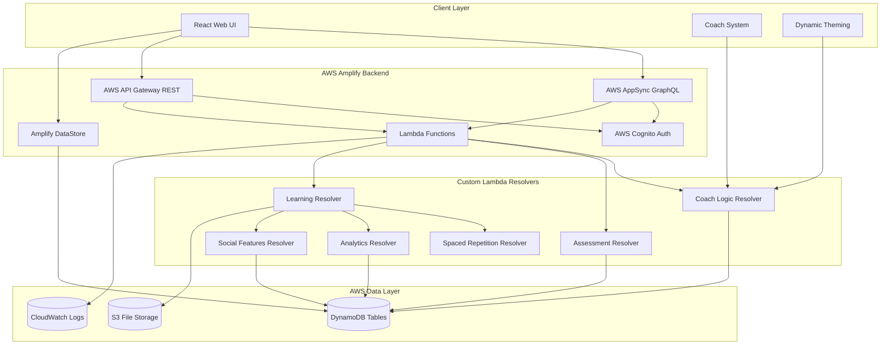

# Zuno Learning App - Design Document

## Overview

Zuno is a sophisticated adaptive learning platform that combines personalized AI-driven education with engaging coach personalities. The system architecture supports four distinct learning modalities through animal coaches, each with unique visual themes and pedagogical approaches. The platform leverages spaced repetition algorithms, assessment-driven learning paths, and intelligent content adaptation to maximize learning efficiency while maintaining professional design standards.

The core philosophy centers on "learning what you don't know" through continuous assessment and adaptive content delivery, wrapped in an engaging but never childish user experience.

## Documentation Strategy

### Context7 Documentation Integration

This design document will be supported by comprehensive documentation retrieved through Context7 to ensure accurate implementation of all technical components. The following documentation areas will be researched and integrated:

#### Technical Architecture Documentation
- **AWS Amplify Architecture**: Complete documentation on Amplify project structure, CLI usage, and best practices for full-stack serverless development
- **GraphQL Schema Design**: AppSync-specific schema patterns, authorization rules, and real-time subscription implementation
- **DynamoDB Data Modeling**: Single-table design patterns, GSI optimization, and access pattern documentation
- **React Architecture**: Modern React patterns, Context API usage, and performance optimization techniques

#### Implementation-Specific Documentation
- **Authentication Flows**: AWS Cognito integration patterns, JWT handling, and secure session management
- **Real-time Features**: AppSync subscription patterns, offline sync strategies, and conflict resolution
- **UI Component Libraries**: shadcn/ui implementation guides, Tailwind CSS best practices, and accessibility compliance
- **Testing Strategies**: Jest configuration, React Testing Library patterns, and AWS testing methodologies

#### Performance and Optimization Documentation
- **Bundle Optimization**: Vite configuration, code splitting strategies, and performance monitoring
- **Accessibility Compliance**: WCAG 2.1 AA implementation guides and testing methodologies
- **Mobile Responsiveness**: Progressive Web App patterns and cross-device compatibility
- **Monitoring and Analytics**: CloudWatch integration, performance metrics, and user analytics implementation

This documentation strategy ensures that all design decisions are backed by current best practices and official recommendations from technology providers.

## Architecture

### High-Level System Architecture



### Technology Stack

**Frontend:**
- React 18.3.1 for web development
- TypeScript for type safety and better developer experience
- React Router for client-side routing and navigation
- Tailwind CSS for utility-first styling
- shadcn/ui for consistent component library

**Backend:**
- AWS Amplify for full-stack serverless development
- AWS AppSync for managed GraphQL API with real-time subscriptions
- AWS API Gateway for REST API endpoints with Lambda integration
- AWS DynamoDB with auto-generated resolvers
- AWS Lambda for custom business logic resolvers
- AWS Cognito for authentication and user management
- Amazon S3 for file storage and media assets

**State Management:**
- React Context for global state management
- Amplify DataStore for offline-first state management
- GraphQL hooks for real-time data operations
- REST API hooks for traditional CRUD operations
- React Hook Form with Zod validation
- Amplify DataStore for client-side persistence and sync

**Infrastructure:**
- AWS Amplify Hosting for serverless web deployment
- DynamoDB for scalable NoSQL database
- CloudFront CDN (managed by Amplify)
- AWS SES for email notifications
- AppSync subscriptions for real-time collaborative features
- API Gateway for REST endpoints and file upload operations

## Components and Interfaces

### 1. Coach System Architecture

The coach system is the heart of Zuno's personalized experience, managing four distinct learning personalities:

```typescript
interface Coach {
  id: 'elia' | 'skippy' | 'lupa' | 'polpo';
  name: string;
  personality: CoachPersonality;
  visualTheme: VisualTheme;
  learningStrategy: LearningStrategy;
  messagingTone: MessagingTone;
}

interface CoachPersonality {
  approach: 'deep' | 'fast' | 'collaborative' | 'adaptive';
  characteristics: string[];
  interactionStyle: InteractionStyle;
}

interface VisualTheme {
  primaryColors: string[];
  secondaryColors: string[];
  iconography: IconSet;
  animations: AnimationSet;
  logo: LogoConfig;
}
```

**Coach Implementations:**

- **Elia (Elephant)**: Deep learning with extended explanations, warm earthy colors, stable animations
- **Skippy (Squirrel)**: Quick exploration with varied content, energetic colors, dynamic animations  
- **Lupa (Wolf)**: Collaborative learning with social features, deep warm colors, connection-themed elements
- **Polpo (Octopus)**: Adaptive hybrid approach, intelligent color shifting, flexible iconography

### 2. Assessment Engine

The assessment engine drives Zuno's "focus on what you don't know" philosophy:

```typescript
interface AssessmentEngine {
  conductInitialAssessment(subject: string, userId: string): Promise<KnowledgeMap>;
  generateSkillMap(assessmentResults: AssessmentResult[]): SkillMap;
  identifyKnowledgeGaps(skillMap: SkillMap): KnowledgeGap[];
  scheduleReassessment(userId: string, topic: string): void;
  updateLearningPath(userId: string, newGaps: KnowledgeGap[]): Promise<LearningPath>;
}

interface KnowledgeMap {
  userId: string;
  subject: string;
  masteredConcepts: Concept[];
  inProgressConcepts: Concept[];
  unknownConcepts: Concept[];
  confidenceScores: Map<string, number>;
  lastUpdated: Date;
}

interface SkillMap {
  visualRepresentation: SkillNode[];
  progressPercentage: number;
  focusAreas: string[];
  nextRecommendations: string[];
}
```

### 3. Adaptive Learning Engine

The core learning system that personalizes content delivery:

```typescript
interface LearningEngine {
  generateDailyLesson(userId: string, coachId: string): Promise<Lesson>;
  adaptDifficulty(userId: string, performance: Performance): Promise<DifficultyLevel>;
  scheduleSpacedRepetition(userId: string, concept: string, performance: number): void;
  trackLearningProgress(userId: string, lessonId: string, results: LessonResults): void;
}

interface Lesson {
  id: string;
  title: string;
  duration: number; // 3-5 minutes
  difficulty: DifficultyLevel;
  content: LessonContent[];
  interactiveElements: InteractiveElement[];
  coachPersonalization: CoachPersonalization;
}

interface InteractiveElement {
  type: 'quiz' | 'practice' | 'mini-game' | 'simulation';
  content: any;
  expectedDuration: number;
  learningObjectives: string[];
}
```

### 4. Spaced Repetition System

Implementation of scientifically-backed spaced repetition algorithms:

```typescript
interface SpacedRepetitionEngine {
  calculateNextReview(concept: string, performance: number, previousInterval: number): Date;
  scheduleReviews(userId: string, completedConcepts: string[]): Promise<ReviewSchedule>;
  adjustIntervals(userId: string, reviewResults: ReviewResult[]): void;
  generateReviewSession(userId: string): Promise<ReviewSession>;
}

// Using modified SM-2 algorithm with personalization
interface ReviewSchedule {
  userId: string;
  scheduledReviews: ScheduledReview[];
  nextReviewDate: Date;
  totalPendingReviews: number;
}
```

### 5. Social Learning System (Lupa Mode)

Collaborative learning features for Wolf mode users:

```typescript
interface SocialLearningSystem {
  createStudyGroup(userId: string, subject: string): Promise<StudyGroup>;
  joinGroupSession(userId: string, sessionId: string): Promise<GroupSession>;
  facilitateGroupChallenge(groupId: string, challenge: Challenge): Promise<GroupChallenge>;
  enablePeerInteraction(sessionId: string, interactionType: InteractionType): void;
}

interface GroupSession {
  id: string;
  participants: User[];
  subject: string;
  activities: GroupActivity[];
  chatEnabled: boolean;
  voiceEnabled: boolean;
  duration: number;
}
```

### 6. Dynamic Theming System

Responsive visual system that adapts to coach selection while maintaining professional, engaging aesthetics:

```typescript
interface ThemingEngine {
  applyCoachTheme(coachId: string): Promise<ThemeConfig>;
  transitionBetweenThemes(fromCoach: string, toCoach: string): Promise<void>;
  customizeThemeElements(userId: string, preferences: ThemePreferences): void;
  maintainBrandConsistency(coachTheme: ThemeConfig): ThemeConfig;
  applyVisualEnhancements(theme: ThemeConfig): EnhancedThemeConfig;
}

interface ThemeConfig {
  colors: ColorPalette;
  typography: TypographyConfig;
  iconography: IconConfig;
  animations: AnimationConfig;
  logos: LogoConfig;
  brandElements: BrandElement[];
  visualEnhancements: VisualEnhancementConfig;
}

interface VisualEnhancementConfig {
  gradients: GradientConfig[];
  cardStyling: CardStyleConfig;
  progressVisualization: ProgressVisualConfig;
  gamificationElements: GamificationVisualConfig;
  motivationalDesign: MotivationalDesignConfig;
}
```

### 7. Professional Visual Design System

Zuno's visual design draws inspiration from modern, colorful learning platforms while maintaining a professional, adult-focused aesthetic:

#### Design Principles

**Colorful but Sophisticated:**
- Use vibrant colors and gradients that energize without overwhelming
- Maintain high contrast ratios for accessibility (WCAG 2.1 AA)
- Coach-specific color palettes that feel professional yet engaging
- Subtle animations and transitions that enhance rather than distract

**Clear Visual Hierarchy:**
- Card-based layouts with clean organization and clear information hierarchy
- Progress visualization through bars, percentages, and completion indicators
- Achievement badges and gamification elements that feel rewarding, not juvenile
- Consistent spacing and typography that guides the eye naturally

**Engaging but Professional:**
- Coach mascots integrated thoughtfully without dominating the interface
- Motivational messaging that encourages without being overly cheerful
- Visual feedback that celebrates progress appropriately for adult learners
- Clean, modern interface elements that inspire confidence and focus

#### Coach-Specific Visual Adaptations

```typescript
interface CoachVisualConfig {
  elia: {
    primaryGradient: 'warm-earth-gradient', // Ochre to light brown
    cardStyle: 'stable-rounded', // Solid, reassuring borders
    progressStyle: 'steady-fill', // Smooth, consistent progress bars
    iconStyle: 'solid-geometric', // Stable, grounded iconography
    motivationalTone: 'encouraging-steady' // Calm, supportive messaging
  },
  skippy: {
    primaryGradient: 'energetic-gradient', // Soft orange to mint green
    cardStyle: 'dynamic-rounded', // Slightly more playful borders
    progressStyle: 'quick-pulse', // Animated progress indicators
    iconStyle: 'dynamic-organic', // Movement-inspired iconography
    motivationalTone: 'upbeat-exploratory' // Energetic but not childish
  },
  lupa: {
    primaryGradient: 'deep-connection-gradient', // Deep blue to copper
    cardStyle: 'connected-grouped', // Cards that visually connect
    progressStyle: 'collaborative-shared', // Progress that shows community
    iconStyle: 'network-connected', // Connection-themed iconography
    motivationalTone: 'community-focused' // Social, supportive messaging
  },
  polpo: {
    primaryGradient: 'adaptive-shifting-gradient', // Teal to coral, context-aware
    cardStyle: 'flexible-morphing', // Adapts based on content type
    progressStyle: 'intelligent-adaptive', // Changes based on learning approach
    iconStyle: 'multi-faceted-flexible', // Icons that adapt to context
    motivationalTone: 'intelligent-adaptive' // Messages that match current approach
  }
}
```

#### Visual Enhancement Components

**Progress Visualization:**
- Animated progress bars with smooth transitions
- Completion percentages prominently displayed
- Streak counters with visual fire/energy elements
- Achievement badges with subtle glow effects
- Level progression with clear visual milestones

**Card-Based Layout System:**
- Course cards with engaging preview images or gradients
- Clear difficulty indicators with color coding
- Time estimates and lesson counts prominently displayed
- Progress overlays that don't obscure important information
- Hover states and micro-interactions for engagement

**Motivational Design Elements:**
- Contextual celebration animations (confetti, subtle particle effects)
- Coach-specific motivational messages with appropriate visual treatment
- "Keep Going!" style encouragement that feels supportive, not patronizing
- Visual feedback for achievements that feels rewarding for adult learners
- Progress milestones that create sense of accomplishment

**Professional Gamification:**
- Badge designs that feel like professional certifications
- Leaderboards with clean, competitive but friendly design
- XP visualization that feels like skill development, not game points
- Achievement unlocks with satisfying but subtle animations
- Social features that encourage collaboration without feeling juvenile

#### Accessibility and Inclusivity

**Visual Accessibility:**
- High contrast ratios across all coach themes
- Color-blind friendly palettes with pattern/texture alternatives
- Scalable text and UI elements for various screen sizes
- Clear focus indicators for keyboard navigation
- Alternative text for all decorative and functional images

**Cultural Sensitivity:**
- Coach designs that avoid cultural stereotypes
- Color choices that work across different cultural contexts
- Inclusive representation in any human imagery
- Language and visual metaphors that translate globally
- Respectful integration of animal mascots without appropriation concerns

## Data Models

### DynamoDB Table Design

**Users Table**
- Partition Key: `userId` (string)
- Attributes: All user data in single item for efficient access

```typescript
interface UserDynamoDBItem {
  userId: string; // Partition Key
  email: string;
  profile: {
    displayName: string;
    learningGoals: string[];
    preferredSubjects: string[];
    dailyLearningTime: number;
    timezone: string;
    language: string;
  };
  selectedCoach: CoachId;
  subscriptionTier: 'free' | 'premium';
  preferences: {
    notificationSettings: NotificationSettings;
    gamificationLevel: 'minimal' | 'moderate' | 'full';
    focusModeEnabled: boolean;
    offlineContentEnabled: boolean;
    personalizedMessaging: boolean;
  };
  privacySettings: PrivacySettings;
  createdAt: string; // ISO string
  lastActive: string; // ISO string
  ttl?: number; // For data retention policies
}
```

**LearningProgress Table**
- Partition Key: `userId` (string)
- Sort Key: `subject` (string)
- GSI: `subject-lastUpdated-index` for subject-based queries

```typescript
interface LearningProgressDynamoDBItem {
  userId: string; // Partition Key
  subject: string; // Sort Key
  currentLevel: number;
  experiencePoints: number;
  streak: {
    current: number;
    longest: number;
    lastLessonDate: string;
  };
  completedLessons: string[];
  knowledgeMap: {
    masteredConcepts: string[];
    inProgressConcepts: string[];
    unknownConcepts: string[];
    confidenceScores: Record<string, number>;
  };
  performanceMetrics: {
    averageAccuracy: number;
    learningVelocity: number;
    retentionRate: number;
    engagementScore: number;
    difficultyProgression: string[];
  };
  lastUpdated: string; // ISO string for GSI
}
```

**Content Table**
- Partition Key: `contentId` (string)
- GSI: `subject-difficulty-index` for content discovery

```typescript
interface ContentDynamoDBItem {
  contentId: string; // Partition Key
  type: 'lesson' | 'assessment' | 'review' | 'challenge';
  subject: string; // GSI Partition Key
  difficulty: string; // GSI Sort Key
  prerequisites: string[];
  learningObjectives: string[];
  estimatedDuration: number;
  coachAdaptations: {
    [coachId: string]: {
      personalizedContent: any;
      messagingTone: string;
      visualElements: any[];
      interactionStyle: string;
    };
  };
  interactiveElements: any[];
  metadata: {
    createdAt: string;
    updatedAt: string;
    version: string;
    tags: string[];
  };
  s3ContentUrl?: string; // For large content stored in S3
}

**SpacedRepetition Table**
- Partition Key: `userId` (string)
- Sort Key: `conceptId` (string)
- GSI: `userId-nextReviewDate-index` for scheduling

interface SpacedRepetitionDynamoDBItem {
  userId: string; // Partition Key
  conceptId: string; // Sort Key
  nextReviewDate: string; // ISO string, GSI Sort Key
  interval: number; // Days until next review
  easeFactor: number; // SM-2 algorithm ease factor
  repetitions: number; // Number of successful repetitions
  lastReviewDate: string;
  performanceHistory: number[]; // Recent performance scores
}

**StudyGroups Table** (for Lupa collaborative learning)
- Partition Key: `groupId` (string)
- GSI: `subject-createdAt-index` for group discovery

interface StudyGroupDynamoDBItem {
  groupId: string; // Partition Key
  subject: string; // GSI Partition Key
  createdAt: string; // GSI Sort Key
  createdBy: string; // userId
  members: string[]; // userIds
  maxMembers: number;
  isActive: boolean;
  currentSession?: {
    sessionId: string;
    startTime: string;
    participants: string[];
  };
  groupSettings: {
    isPublic: boolean;
    allowChat: boolean;
    allowVoice: boolean;
  };
}

**GroupSessions Table** (for real-time collaborative sessions)
- Partition Key: `sessionId` (string)
- GSI: `groupId-startTime-index` for session history

interface GroupSessionDynamoDBItem {
  sessionId: string; // Partition Key
  groupId: string; // GSI Partition Key
  startTime: string; // GSI Sort Key
  endTime?: string;
  participants: {
    userId: string;
    joinTime: string;
    leaveTime?: string;
  }[];
  activities: {
    activityId: string;
    type: 'challenge' | 'discussion' | 'quiz';
    startTime: string;
    results: Record<string, any>;
  }[];
  chatMessages: {
    messageId: string;
    userId: string;
    message: string;
    timestamp: string;
  }[];
}

**Assessments Table** (for assessment-driven learning)
- Partition Key: `userId` (string)
- Sort Key: `assessmentId` (string)
- GSI: `subject-completedAt-index` for analytics

interface AssessmentDynamoDBItem {
  userId: string; // Partition Key
  assessmentId: string; // Sort Key (subject#timestamp format)
  subject: string; // GSI Partition Key
  completedAt: string; // GSI Sort Key
  assessmentType: 'initial' | 'progress' | 'focus-check';
  results: {
    conceptId: string;
    score: number;
    confidence: number;
    timeSpent: number;
  }[];
  knowledgeGaps: string[]; // conceptIds where user struggled
  masteredConcepts: string[]; // conceptIds user knows well
  recommendedFocus: string[]; // priority areas for learning
}

**Leaderboards Table** (for gamification)
- Partition Key: `leaderboardType` (string) - format: "subject#coach#timeframe"
- Sort Key: `score#userId` (string) - for ranking

interface LeaderboardDynamoDBItem {
  leaderboardType: string; // Partition Key: "math#elia#weekly"
  scoreUserId: string; // Sort Key: "1250#user123"
  userId: string;
  score: number;
  rank: number;
  displayName: string;
  coachId: string;
  subject: string;
  timeframe: 'daily' | 'weekly' | 'monthly' | 'alltime';
  lastUpdated: string;
}

**Achievements Table** (for badges and milestones)
- Partition Key: `userId` (string)
- Sort Key: `achievementId` (string)
- GSI: `achievementType-earnedAt-index` for analytics

interface AchievementDynamoDBItem {
  userId: string; // Partition Key
  achievementId: string; // Sort Key
  achievementType: string; // GSI Partition Key
  earnedAt: string; // GSI Sort Key
  title: string;
  description: string;
  badgeIcon: string;
  coachId?: string; // If coach-specific achievement
  subject?: string; // If subject-specific achievement
  metadata: {
    triggerValue: number; // e.g., streak length, score achieved
    category: 'streak' | 'mastery' | 'social' | 'consistency';
  };
}
```

## Error Handling

### Graceful Degradation Strategy

1. **Offline Mode**: Cache essential content and sync when reconnected
2. **Network Issues**: Provide cached content and queue user actions
3. **AI Service Failures**: Fall back to rule-based systems
4. **Coach System Failures**: Default to neutral Zuno branding
5. **Assessment Failures**: Use performance-based adaptation

### Error Recovery Patterns

```typescript
interface ErrorHandler {
  handleNetworkError(error: NetworkError): Promise<RecoveryAction>;
  handleContentLoadError(contentId: string): Promise<AlternativeContent>;
  handleAssessmentError(assessmentId: string): Promise<FallbackAssessment>;
  handleCoachSystemError(coachId: string): Promise<NeutralExperience>;
}

enum RecoveryAction {
  RETRY_WITH_CACHE = 'retry_with_cache',
  FALLBACK_TO_OFFLINE = 'fallback_to_offline',
  SHOW_ERROR_MESSAGE = 'show_error_message',
  GRACEFUL_DEGRADATION = 'graceful_degradation'
}
```

## Testing Strategy

### Testing Pyramid

**Unit Tests (70%)**
- Coach personality logic
- Spaced repetition algorithms
- Assessment scoring
- Theme switching logic
- Data model validation

**Integration Tests (20%)**
- API endpoint functionality
- Database operations
- Third-party service integration
- Coach system integration
- Analytics pipeline

**End-to-End Tests (10%)**
- Complete user journeys
- Cross-coach switching
- Offline/online synchronization
- Payment flow testing
- Social learning scenarios

### AWS Amplify Implementation Details

**Amplify Configuration:**
```yaml
# amplify/backend/backend-config.json
{
  "auth": {
    "zunoauth": {
      "service": "Cognito",
      "providerPlugin": "@aws-amplify/amplify-category-auth"
    }
  },
  "api": {
    "zunoapi": {
      "service": "AppSync",
      "providerPlugin": "@aws-amplify/amplify-category-api"
    }
  },
  "storage": {
    "zunostorage": {
      "service": "DynamoDB",
      "providerPlugin": "@aws-amplify/amplify-category-storage"
    }
  },
  "function": {
    "coachLogic": {
      "service": "Lambda",
      "providerPlugin": "@aws-amplify/amplify-category-function"
    }
  }
}
```

**DynamoDB Access Patterns Analysis:**

Based on requirements review, we need these access patterns:

1. **User Management:**
   - Get user profile by userId
   - Update user preferences and coach selection
   - Query users by subscription tier (for analytics)

2. **Learning Progress & Analytics:**
   - Get user progress by userId + subject
   - Query all subjects for a user (dashboard)
   - Get leaderboard data by subject (gamification)
   - Track streaks and experience points
   - Generate skill maps and analytics

3. **Content Discovery & Delivery:**
   - Get content by difficulty and subject
   - Find content by prerequisites
   - Get coach-specific adaptations
   - Query content by learning objectives

4. **Spaced Repetition:**
   - Get due reviews by userId and date range
   - Update review intervals based on performance
   - Query concepts needing review

5. **Social Learning (Lupa Mode):**
   - Create and join study groups
   - Real-time group sessions
   - Peer interaction and chat
   - Group challenges and achievements

6. **Assessment System:**
   - Store and retrieve assessment results
   - Generate knowledge maps
   - Track concept mastery over time

7. **Gamification:**
   - Leaderboards by subject and coach
   - Badge and achievement tracking
   - Streak maintenance across users

**Complete DynamoDB Access Patterns:**

1. `GetUser(userId)` - Users table
2. `GetUserProgress(userId, subject)` - LearningProgress table
3. `QueryUserAllProgress(userId)` - LearningProgress table
4. `GetContent(contentId)` - Content table
5. `QueryContentBySubjectDifficulty(subject, difficulty)` - Content GSI
6. `GetDueReviews(userId, dateRange)` - SpacedRepetition GSI
7. `QueryStudyGroups(subject)` - StudyGroups GSI
8. `GetGroupSession(sessionId)` - GroupSessions table
9. `QueryGroupSessions(groupId)` - GroupSessions GSI
10. `GetUserAssessments(userId)` - Assessments table
11. `QueryAssessmentsBySubject(subject)` - Assessments GSI
12. `GetLeaderboard(subject, coach, timeframe)` - Leaderboards table
13. `GetUserAchievements(userId)` - Achievements table
14. `QueryAchievementsByType(achievementType)` - Achievements GSI

### Testing Frameworks

- **Frontend**: Jest + React Native Testing Library
- **Backend**: Jest + AWS SDK mocks for Lambda testing
- **E2E**: Detox for React Native E2E testing
- **AWS Integration**: AWS SAM CLI for local Lambda testing
- **Performance**: AWS X-Ray for distributed tracing
- **Accessibility**: axe-core for accessibility compliance

### Coach-Specific Testing

Each coach mode requires dedicated testing scenarios:

```typescript
describe('Coach System Testing', () => {
  describe('Elia (Elephant) Mode', () => {
    test('provides deep explanations for complex topics');
    test('uses warm, stable visual elements');
    test('maintains reflective pacing');
  });
  
  describe('Skippy (Squirrel) Mode', () => {
    test('delivers quick, varied content');
    test('uses energetic visual elements');
    test('maintains rapid progression');
  });
  
  describe('Lupa (Wolf) Mode', () => {
    test('enables collaborative features');
    test('facilitates group interactions');
    test('maintains social connectivity');
  });
  
  describe('Polpo (Octopus) Mode', () => {
    test('adapts approach based on content');
    test('intelligently combines strategies');
    test('maintains flexible theming');
  });
});
```

### Performance Testing

- **Load Testing**: Simulate concurrent users in group sessions
- **Stress Testing**: Test system limits with heavy assessment loads
- **Spike Testing**: Handle sudden increases in user activity
- **Volume Testing**: Manage large amounts of learning content
- **Endurance Testing**: Long-term stability of spaced repetition scheduling

### Accessibility Testing

- **Screen Reader Compatibility**: Full VoiceOver/TalkBack support
- **Color Contrast**: WCAG 2.1 AA compliance across all coach themes
- **Motor Accessibility**: Support for switch control and voice commands
- **Cognitive Accessibility**: Clear navigation and consistent patterns
- **Internationalization**: RTL language support and cultural adaptations

This comprehensive design provides a solid foundation for implementing all the requirements while maintaining scalability, performance, and user experience quality across all coach modalities and learning scenarios.

## Alternative: Single Table Design

As an alternative to the multi-table approach above, we could implement a single table design following DynamoDB best practices for maximum performance and cost efficiency:

### Single Table Schema

**ZunoTable** (Single table for all entities)
- Partition Key: `PK` (string)
- Sort Key: `SK` (string)
- GSI1: `GSI1PK` / `GSI1SK`
- GSI2: `GSI2PK` / `GSI2SK`
- GSI3: `GSI3PK` / `GSI3SK`

### Entity Patterns

```typescript
// User Profile
PK: "USER#userId"
SK: "PROFILE"
GSI1PK: "COACH#coachId"
GSI1SK: "USER#userId"

// Learning Progress
PK: "USER#userId"
SK: "PROGRESS#subject"
GSI1PK: "SUBJECT#subject"
GSI1SK: "LEVEL#currentLevel#userId"

// Content
PK: "CONTENT#contentId"
SK: "METADATA"
GSI1PK: "SUBJECT#subject"
GSI1SK: "DIFFICULTY#difficulty#contentId"

// Spaced Repetition
PK: "USER#userId"
SK: "REVIEW#conceptId"
GSI1PK: "REVIEWS#userId"
GSI1SK: "DUE#nextReviewDate#conceptId"

// Study Groups
PK: "GROUP#groupId"
SK: "METADATA"
GSI1PK: "SUBJECT#subject"
GSI1SK: "CREATED#createdAt#groupId"

// Group Sessions
PK: "GROUP#groupId"
SK: "SESSION#sessionId"
GSI1PK: "SESSION#sessionId"
GSI1SK: "STARTED#startTime"

// Assessments
PK: "USER#userId"
SK: "ASSESSMENT#subject#timestamp"
GSI1PK: "SUBJECT#subject"
GSI1SK: "COMPLETED#completedAt#userId"

// Leaderboards
PK: "LEADERBOARD#subject#coach#timeframe"
SK: "SCORE#score#userId"
GSI1PK: "USER#userId"
GSI1SK: "LEADERBOARD#subject#coach#timeframe"

// Achievements
PK: "USER#userId"
SK: "ACHIEVEMENT#achievementId"
GSI1PK: "ACHIEVEMENT#achievementType"
GSI1SK: "EARNED#earnedAt#userId"
```

### Single Table Access Patterns

1. **Get User Profile**: `Query(PK="USER#userId", SK="PROFILE")`
2. **Get User Progress**: `Query(PK="USER#userId", SK begins_with "PROGRESS#")`
3. **Get Content by Subject**: `Query(GSI1, GSI1PK="SUBJECT#subject")`
4. **Get Due Reviews**: `Query(GSI1, GSI1PK="REVIEWS#userId", GSI1SK between "DUE#today" and "DUE#tomorrow")`
5. **Get Study Groups**: `Query(GSI1, GSI1PK="SUBJECT#subject")`
6. **Get Leaderboard**: `Query(PK="LEADERBOARD#subject#coach#timeframe")`
7. **Get User Achievements**: `Query(PK="USER#userId", SK begins_with "ACHIEVEMENT#")`

### Single Table Benefits

- **Cost Efficiency**: Single table reduces costs compared to multiple tables
- **Performance**: All related data can be retrieved in single queries
- **Atomic Transactions**: Cross-entity transactions within single table
- **Simplified Backup**: Single table backup and restore
- **Consistent Scaling**: Single table auto-scaling configuration

### Single Table Considerations

- **Complex Access Patterns**: Requires careful GSI design for all query patterns
- **Item Size Limits**: 400KB limit per item may constrain large content
- **Hot Partitions**: Need to ensure even distribution across partition keys
- **Schema Evolution**: Changes require careful migration planning
- **Debugging Complexity**: Harder to inspect data compared to separate tables

### Recommendation

For Zuno's requirements, the **multi-table approach** is recommended initially because:
- Clearer data separation and easier development
- Simpler debugging and data inspection
- Better alignment with different access patterns
- Easier to optimize individual tables
- More straightforward for team development

The single table design could be considered for optimization once the application scales and cost efficiency becomes critical.


## Refactoring Plan Summary

### Current Architecture Analysis
Based on the steering documents, the current LearnDaily Pro system has:
- **React 18.3.1 + TypeScript** with Next.js patterns and Tailwind CSS
- **@uibakery/data** for database operations with PostgreSQL
- **3-coach system** (Elia, Skippy, Lupa) managed via CoachContext
- **Existing components**: CourseCatalog, UserProfile, OnboardingFlow, CoachSelection, LessonViewer
- **Actions layer** with SQL-based operations for courses, users, lessons, progress
- **UI components** following shadcn/ui patterns in components/ui/

### Key Refactoring Priorities

#### 1. Brand Migration (Phase 1, Task 1)
- **Impact**: All user-facing text, package.json, app.tsx header
- **Files to update**: package.json, app.tsx, product.md steering doc
- **Risk**: Low - mostly text changes

#### 2. Coach System Extension (Phase 1, Task 2)
- **Impact**: CoachContext, CoachSelection component, theming system
- **Files to update**: contexts/CoachContext.tsx, components/CoachSelection.tsx, globals.css, types/index.ts
- **Risk**: Medium - affects core theming and state management

#### 3. Database Schema Evolution (Multiple phases)
- **New tables needed**: assessments, spaced_repetition_cards, review_sessions, skill_maps, difficulty_adjustments
- **Migration strategy**: Incremental migrations in /migrations/ with timestamp prefixes
- **Risk**: High - requires careful data migration and backward compatibility

#### 4. Component Architecture Extensions
- **New components needed**: AssessmentEngine, SkillMapDashboard, SpacedRepetitionEngine, ReviewNotifications
- **Existing component enhancements**: LessonViewer (review mode), UserProfile (analytics), CourseCatalog (assessment-driven)
- **Risk**: Medium - requires maintaining existing functionality while adding new features

#### 5. Actions Layer Expansion
- **New actions**: loadAssessment, createAssessment, loadSkillMap, loadDueReviews, completeReview, scheduleReview
- **Enhanced actions**: loadLessons (gap prioritization), completeLessonProgress (re-assessment), loadUserProfile (analytics)
- **Risk**: Medium - must maintain existing SQL patterns and error handling

### Implementation Strategy
1. **Start with low-risk brand migration** to establish Zuno identity
2. **Extend coach system incrementally** to avoid breaking existing theming
3. **Add new database tables** before implementing dependent features
4. **Build new components alongside existing ones** to maintain functionality
5. **Enhance existing actions gradually** with backward compatibility
6. **Test each phase thoroughly** before proceeding to next phase

### Architecture Consistency Rules
- **Use Amplify GraphQL patterns** for all database operations (replacing @uibakery/data)
- **Follow React Native + TypeScript conventions** in types/index.ts
- **Use React Native UI library patterns** for all new components (replacing shadcn/ui)
- **Preserve CoachContext integration** for all new features with React Native state management
- **Use Amplify GraphQL operations** for database operations (replacing SQL-based actions)
- **Implement React Native styling patterns** for theming (replacing Tailwind + CSS)
- **Follow mobile-first design principles** for all UI components and interactions
- **Ensure cross-platform compatibility** between iOS and Android